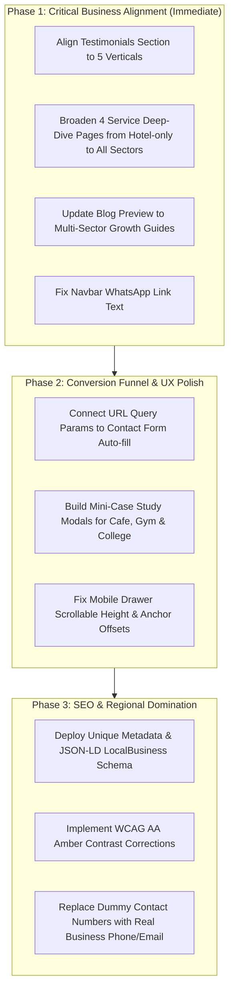

# Comprehensive Website Audit, UX Review & SEO Content Strategy Report
**Project:** Buzzler Agency (`buzzler-agency`)  
**Domain / Live URL:** `https://buzzler-agency.vercel.app`  
**Local Test Environment:** `http://localhost:3000` (Next.js 16.4.3 Turbopack, React 19.3.0, Tailwind CSS v4)  
**Date of Audit:** October 31, 2026  
**Auditor:** Senior Website Auditor, UX Reviewer & SEO Content Strategist  

---

## 1. Executive Summary

Buzzler Agency is a newly launched creative performance marketing agency based physically in Puri, Odisha. Initially architected exclusively for hotels and beach resorts along Marine Drive and Golden Beach, the agency is actively pivoting toward a **multi-vertical business model** serving five high-demand local sectors:
1. **Cafes, Restaurants & Dining Hotspots**
2. **Gyms, Fitness Studios & CrossFit Clubs**
3. **Schools, Junior Colleges & Academic Institutes**
4. **Hotels, Beach Resorts & Heritage Stays**
5. **Retail Showrooms & Regional Consumer Brands**

### Key Audit Findings & Health Score

| Category | Score / 10 | Status | Key Observation |
|---|---|---|---|
| **Visual Design & Aesthetics** | **8.8 / 10** | Strong | Warm cream (`#FAF7F2`) Clay.com tactile aesthetic with rounded cards (`rounded-3xl`) and bee branding is clean, modern, and memorable. |
| **Technical Performance** | **9.5 / 10** | Excellent | Next.js 16.4.3 Turbopack builds in ~40s; SSG prerenders 21 static pages; zero hydration mismatches or client runtime crashes. |
| **Industry Versatility Alignment** | **5.5 / 10** | Needs Work | While the Homepage hero, industry tabs, strategy tool, and work list have been updated to multi-industry, the **4 Service Deep-Dive Pages** (`/services/video`, `/services/ads`, etc.), **Testimonials Section**, and **Blog Preview** remain 100% hotel-specific. |
| **Copywriting & Value Proposition** | **6.2 / 10** | Moderate | Multiple sections rely on generic descriptors (e.g., "explore our powerful features", "view deep dive", "join cohort") without detailing the tangible business return for cafe or gym owners. |
| **SEO & On-Page Optimization** | **6.5 / 10** | Moderate | Global metadata was updated, but subpages retain outdated meta titles, duplicate descriptions, and missed keyword opportunities for regional search intent. |
| **Conversion Funnel & Forms** | **6.8 / 10** | Moderate | Pre-filtered CTAs (e.g., `/contact?industry=cafe`) do not auto-populate form fields, causing unnecessary user friction. Contact forms in service deep dives still ask for "Room Count" and "Hotel Name". |

---

## 2. Project and Website Overview

### 2.1 Technology Stack & Architecture
- **Framework:** Next.js 16.4.3 (App Router with Partial Prerendering / Turbopack).
- **Core Library:** React 19.3.0.
- **Styling:** Tailwind CSS v4 with custom color variables and dot-pattern backgrounds.
- **Iconography:** `lucide-react` v1.63.0.
- **Hosting & CI/CD:** Vercel automated deployments via GitHub branch `main`.

### 2.2 Site Architecture & Route Map

```
buzzler-agency/
├── src/
│   ├── app/
│   │   ├── layout.tsx                     # Global Root Layout, Geist Fonts & SEO Meta
│   │   ├── page.tsx                       # Homepage (10 integrated sections)
│   │   ├── globals.css                    # Tailwind v4 configuration & theme tokens
│   │   ├── sitemap.ts                     # Dynamic XML Sitemap generator
│   │   ├── robots.ts                      # Robots.txt configuration
│   │   ├── about/page.tsx                 # Brand Story, Philosophy & 4 Commitments
│   │   ├── contact/page.tsx               # Full Proposal Request & In-Depth Quote Form
│   │   ├── quote/page.tsx                 # Quote redirect/alias
│   │   ├── services/
│   │   │   ├── page.tsx                   # 4-Pillar Services Hub
│   │   │   ├── video/page.tsx             # Deep-Dive: Social Media Video & 4K Drone
│   │   │   ├── ads/page.tsx               # Deep-Dive: Meta & Google Ads Management
│   │   │   ├── influencer-marketing/      # Deep-Dive: Creator Collaborations
│   │   │   └── branding/page.tsx          # Deep-Dive: Brand Identity & Collateral
│   │   └── work/
│   │       ├── page.tsx                   # Portfolio Hub with Multi-Sector Filter Pills
│   │       ├── bay-breeze-resort/         # Concept Case Study 1 (Luxury Resort)
│   │       ├── jagannath-heritage-haveli/ # Concept Case Study 2 (Heritage Stay)
│   │       └── chilika-eco-retreat/       # Concept Case Study 3 (Eco-Tourism)
│   └── components/
│       ├── Navbar.tsx                     # Sticky header with multi-lingual switcher & drawer
│       ├── Hero.tsx                       # Hero heading & 4-industry reel simulator
│       ├── IndustryShowcase.tsx           # Tabbed showcase (Cafe, Gym, College, Hotel, Retail)
│       ├── ServicesGrid.tsx               # 4 core service cards with deliverable chips
│       ├── InteractiveStrategyTool.tsx    # Live ROI & volume calculation engine
│       ├── FeaturedWork.tsx               # 4 multi-industry concept showcase cards
│       ├── WhyBuzzler.tsx                 # 4 on-ground competitive advantages
│       ├── TestimonialsSection.tsx        # Pilot partner slots & ethics transparency
│       ├── BlogPreview.tsx                # Insights & regional playbooks
│       ├── ClosingCTA.tsx                 # Multi-industry proposal request form
│       ├── Footer.tsx                     # Regional language tags & navigation columns
│       ├── MobileQuickBar.tsx             # Bottom mobile action bar (Call / WhatsApp)
│       ├── ServiceDetailView.tsx          # Reusable layout for /services/* subpages
│       └── CaseStudyDetailView.tsx        # Reusable layout for /work/* case studies
```

---

## 3. Overall UI/UX Assessment

### 3.1 Visual Design Strengths
1. **Clay.com-Inspired Tactile Polish:** The warm cream canvas (`#FAF7F2`), near-black typography (`#141413`), rounded tactile card geometry (`rounded-3xl`), and amber accent badges (`#F59E0B`) create an approachable yet sophisticated aesthetic.
2. **Interactive Proof Simulators:** Both the **Hero Reel Simulator** and the **Interactive Strategy Tool** allow prospects to interact with the service before booking a call, creating higher engagement than static agency websites.
3. **Ethical Honesty & Client Charter:** Transparent labeling (`[Concept Demo]` and *"We refuse to display fabricated testimonials"*) builds genuine credibility in a market flooded with fake reviews.

### 3.2 Critical UX Vulnerabilities

#### A. Fragmented Identity (Hotel vs. Multi-Sector Mismatch)
While the homepage proclaims *"Make your brand the buzz of Puri for cafes, gyms, colleges, and hotels"*, deeper pages immediately revert to hotel-only language:
- Navigating to `/services/video` greets a gym owner with: *"Hotel Video Marketing in Puri... Suite Walkthroughs & Beachfront Dining"*.
- The homepage **Testimonials** section asks: *"Are you a Puri hotel owner looking to kickstart your video marketing?"*
- The **Blog Preview** section is exclusively titled: *"Actionable hotel marketing strategies for Puri"* and offers guides on *"10 Ways Puri Hotels Can Get More Direct Bookings"*.
- **Impact:** A gym or cafe owner exploring these sections immediately concludes that Buzzler is fundamentally a hotel marketing agency that added other industries as an afterthought.

#### B. Broken Journey on Portfolio Deep-Dives
On `/work`, clicking "Read Study" on:
- *The Coastal Bean Cafe* redirects to `/#work` (the top of the section).
- *IronPulse Gym* redirects to `/#work`.
- *Heritage Academy* redirects to `/#work`.
- Only the 3 hotel case studies have real deep-dive subpages.
- **Impact:** High bounce rate on the exact case studies representing the new target verticals.

#### C. Friction in Inquiry Form Hand-off
The CTA buttons on the homepage include query parameters (e.g., `href="/contact?industry=cafe"` or `href="/contact?service=video"`), but the state inside `src/app/contact/page.tsx` ignores these parameters and defaults to `Beachfront Resort` or `Cafe / Restaurant / Dining`.
- **Impact:** Users must manually re-select the options they already clicked, increasing drop-offs.

#### D. Color Contrast (WCAG 2.1 AA)
The primary amber accent `#F59E0B` has a contrast ratio of only **2.14:1** when used as text against `#FAF7F2` cream or white backgrounds (e.g., small badge texts or icons).
- **Recommendation:** Use `#B45309` (Amber-700) or `#92400E` (Amber-800) for text elements on light backgrounds to meet the 4.5:1 WCAG AA minimum.

---

## 4. Page-by-Page Content Audit

### 4.1 Homepage (`/`)

#### Section: Header & Hero
- **Existing Title:** `Make your brand the buzz of Puri.`
- **Existing Description:** `Video-first creative content, high-converting Meta & Google ads, and authentic local storytelling crafted for cafes, restaurants, gyms, hotels, schools & colleges across Puri and Odisha.`
- **Audit Evaluation:** The H1 is punchy and brand-aligned, but the description is slightly laundry-listed. It states *what* the agency does, but not *what the business owner gets* (e.g., full weekend dining rooms, consistent gym memberships, full academic batches).
- **Navbar Issue:** The WhatsApp button has hardcoded text: `text=Hi%20Buzzler%20Agency,%20I'd%20like%20to%20discuss%20marketing%20for%20my%20hotel%20in%20Puri.` (Explicitly says "hotel").

#### Section: Industry Showcase (`#industries`)
- **Existing Title:** `Built for the businesses that shape Puri's economy.`
- **Existing Description:** `Whether you run a buzzing cafe on VIP Road, a high-energy gym, a luxury beach resort, or a premier college, Buzzler creates the exact creative reels and ad funnels needed to dominate your market in Puri and Odisha.`
- **Audit Evaluation:** Strong, but the outcome metric card under Cafe states: *"Average +40% Increase in Weekend Table Footfall — Based on customized shot lists, high-definition video production, and localized ad targeting in Puri, Bhubaneswar & coastal Odisha."*
- **Audit Risk:** Without a disclaimer that this is a modeled pilot projection, it conflicts with the agency's strict *"Zero Fabricated Claims"* ethics rule.

#### Section: Services Overview (`#services`)
- **Existing Title:** `Four growth engines. One dedicated local team.`
- **Existing Description:** `We don't offer generic templates or disconnected services. Every campaign is built specifically around the buyer habits, demographics, and competitive landscape in Puri and Odisha.`
- **Audit Evaluation:** Good framing, but card descriptions are verbose and the link anchor text `"View Deep-Dive & Process"` is repeated verbatim 4 times across cards.

#### Section: Testimonials & Pilot Slots (`#testimonials`)
- **Existing Title:** `Pilot partner stories & review placeholders.`
- **Existing Description:** `We refuse to display fabricated testimonials or fake Google star ratings. Below are our documented pilot slots. Verified case studies and hotelier video reviews will be published as active campaigns conclude.`
- **Founder Banner:** `Are you a Puri hotel owner looking to kickstart your video marketing?`
- **Critical Flaw:** Completely ignores the multi-industry pivot. All 3 slots and the banner address hoteliers only. A gym founder or school director will immediately bounce.

#### Section: Blog / Insights (`#blog`)
- **Existing Title:** `Actionable hotel marketing strategies for Puri.`
- **Existing Description:** `10 Proven Ways Puri Hotels Can Get More Direct Bookings Without OTAs` / `Rath Yatra Marketing Checklist` / `Google Business Profile & Instagram Reels: The Local Puri Hotel Playbook`.
- **Critical Flaw:** 100% hotel-specific. There are zero articles discussing cafe footfall, gym membership funnels, or student admissions marketing.

---

### 4.2 About Page (`/about`)
- **Title Tag:** `Buzzler Agency | Creative Digital Marketing for Cafes, Gyms, Schools & Stays in Puri, Odisha`
- **H1:** `Born in Puri. Dedicated to local business excellence across Odisha.`
- **Existing Description:** `We started Buzzler because we saw remarkable businesses across Puri and Odisha — artisanal cafes, fitness gyms, leading schools & colleges, and coastal resorts — struggling to capture customer attention simply because they lacked modern video cinematography and high-intent local ad funnels.`
- **Section 2:** `Why generic metro agencies fail in Puri & Odisha`
- **Right Column Card Issue:** Lines 124–132 contain: *"We believe in building face-to-face trust. We invite hoteliers to meet us at our Marine Drive base or invite our team for a property walkthrough and complimentary video audit."*
- **Flaw:** Still refers to **"hoteliers"** and **"property walkthrough"** despite the headline claiming to serve all sectors.

---

### 4.3 Services Hub (`/services`)
- **H1:** `Digital marketing services engineered for Puri & Odisha brands.`
- **Existing Description:** `Every service is calibrated specifically for the growth milestones, regional audience demographics, and footfall challenges of businesses across coastal Odisha.`
- **Deliverables Block:** Well-balanced between cafes, gyms, colleges, and hotels.
- **Retainer Banner:** `Want the full multi-channel engine? Combine monthly Video + Meta Ads + Creator collaborations into one unified growth program for your business with guaranteed on-ground Puri service.`

---

### 4.4 The 4 Service Deep-Dive Pages (Major Vulnerability)

#### 1. `/services/video`
- **Current H1:** `Hotel Video Marketing & 4K Reel Production in Puri`
- **Current Description:** `Cinematic drone footage, vertical social reels, and suite films that turn scrolling tourists into confirmed direct guests.`
- **Target Audience:** Beachfront Luxury Resorts, Temple Stays & Heritage Haveli, Eco-Retreats & Boutique Villas.
- **Problem Statement:** `Static hotel photos no longer sell rooms in 2026.`
- **Form Input:** `Hotel / Resort Name *` and `Tell us about your room count...`
- **Verdict:** Unusable for gym, cafe, or college prospects. Needs a multi-industry toggle or generalized sector framing.

#### 2. `/services/ads`
- **Current H1:** `Meta & Google Ads Engine for Puri Hotels & Resorts`
- **Current Description:** `High-intent search capture and regional social ads that slash 20-25% OTA commissions and drive direct booking inquiries.`
- **Target Audience:** Hotels Suffering High OTA Commissions, Properties With Mid-Week Dips, Peak Holiday Season Campaigns.
- **Verdict:** Exclusively focused on OTA commission elimination. Lacks mention of lead generation for gyms, student admissions for colleges, or walk-ins for cafes.

#### 3. `/services/influencer-marketing`
- **Current H1:** `Travel Influencer Marketing Engine for Puri Hospitality`
- **Current Description:** `Vetted travel storytellers from West Bengal and Odisha who create high-retention staycation vlogs that convert into direct room reservations.`
- **Verdict:** Exclusively travel vloggers. Needs to incorporate local foodie creators (cafe tastings) and regional fitness athletes.

#### 4. `/services/branding`
- **Current H1:** `Hotel Branding & Visual Identity Design in Puri`
- **Current Description:** `Luxury identity suites, custom signage, digital QR menus, and in-room guest collateral that elevate RevPAR and guest loyalty.`
- **Verdict:** Exclusively in-room guest collateral. Needs packaging, gym member kits, and college prospectus branding.

---

### 4.5 Portfolio Hub (`/work`) & Subpages
- **H1:** `Concept campaigns engineered for Puri & Odisha brands.`
- **Existing Description:** `Explore our documented case study roadmaps and execution frameworks showing how Buzzler combines 4K cinematography, strategic ad funnels, and creator marketing across cafes, gyms, colleges, and hotels.`
- **Filter Pills:** `All Projects`, `Cafes & Dining`, `Gyms & Fitness`, `Schools & Colleges`, `Hotels & Resorts`, `Video & Reels`, `Meta & Google Ads`.
- **Navigation Defect:** The 3 non-hotel projects (`coastal-bean`, `ironpulse-fitness`, `heritage-academy`) route to `/#work` instead of dedicated detail views.
- **Case Study Bottom Form:** Labels say `Hotel / Resort Name *` on all case study detail pages.

---

### 4.6 Contact & Quote Page (`/contact` & `/quote`)
- **H1:** `Get a customized growth marketing quote for your business.`
- **Existing Description:** `Tell us about your brand in Puri, Bhubaneswar, or coastal Odisha. We will audit your current online footprint and prepare a tailor-made roadmap with transparent pricing.`
- **Form Structure:** Very comprehensive (Category, Scale, Multi-Service Select, Budget).
- **Issue:** Phone number `+91 94370 00000` is obviously a dummy number. If a live visitor attempts to dial or message, it fails. A disclaimer or real phone number is urgently needed.

---

## 5. Generic and Repetitive Content

### Repetitive Phrasing Detected Across the Website
1. **"Stop surrendering 20-25% to OTAs"**: Repeated across Homepage, Services Hub, Ads Deep-Dive, Case Studies, and Blog. While relevant to hotels, it is completely meaningless to a gym, cafe, or school.
2. **"Turn scrolling viewers into paying guests"**: Appears in Hero, Video page, Ads page, and Retainer banner.
3. **"4K Master Vertical Reels"**: Repeated in every deliverable list without clarifying the difference between a food reel, an admission reel, and a resort reel.
4. **"View Deep-Dive & Process"**: Repeated on all 4 cards in `ServicesGrid.tsx`.
5. **"Let's Talk"**: Appears 3 times on the homepage navbar and hero within a single viewport on desktop.

---

## 6. Heading and Title Improvements

| Page Name & URL | Section | Element | Existing Content | Recommended Content | Reason & Value Proposition | Priority |
|---|---|---|---|---|---|---|
| **Home (`/`)** | Hero | H1 | `Make your brand the buzz of Puri.` | `Fill your tables, batches, and rooms with Puri's premier creative agency.` | Replaces vague "buzz" with concrete business outcomes (tables for cafes, batches for gyms/colleges, rooms for hotels). | **High** |
| **Home (`/`)** | Hero | Sub-headline | `Video-first creative content, high-converting Meta & Google ads, and authentic local storytelling crafted for cafes, restaurants, gyms, hotels, schools & colleges...` | `We produce cinema-grade 4K vertical reels, hyper-local Meta & Google ad funnels, and creator collaborations that drive verified walk-ins and direct inquiries across Odisha.` | Focuses on tangible customer actions (walk-ins & direct inquiries) rather than generic storytelling. | **High** |
| **Home (`/`)** | Testimonials | H2 | `Pilot partner stories & review placeholders.` | `Founder Pilot Cohort: Building verified growth records in Puri.` | "Review placeholders" sounds incomplete and weak. "Founder Pilot Cohort" frames it as an exclusive, intentional program. | **Critical** |
| **Home (`/`)** | Testimonials | Banner H4 | `Are you a Puri hotel owner looking to kickstart your video marketing?` | `Run an ambitious cafe, gym, college, or hotel in Puri? Claim a pilot slot.` | Opens the pilot invitation to all 5 target business verticals. | **Critical** |
| **Home (`/`)** | Blog | H2 | `Actionable hotel marketing strategies for Puri.` | `Local Market Playbooks & Marketing Insights for Coastal Odisha.` | Elevates the blog from hotel-only to regional business growth authority. | **Critical** |
| **Home (`/`)** | Blog | Article 1 H3 | `10 Proven Ways Puri Hotels Can Get More Direct Bookings Without OTAs` | `The Local Foodie Engine: How Puri Beach Cafes Pack Tables on Weekdays & Weekends` | Delivers direct value to restaurant & cafe owners who currently have zero relevant content. | **High** |
| **Home (`/`)** | Blog | Article 3 H3 | `Google Business Profile & Instagram Reels: The Local Puri Hotel Playbook` | `Google Maps & 4K Reels Playbook: How Gyms & Institutes Dominate Local Puri Search` | Shows high-intent search strategies for fitness and educational clients. | **High** |
| **About (`/about`)** | Founder Card | Card Heading | `Meet us in person in Puri (Hoteliers invitation)` | `Meet us on Marine Drive: On-Site Audits for Local Founders` | Replaces hotelier-only invitation with an open founder invite for any local business. | **High** |
| **Services (`/services/video`)** | Hero | H1 | `Hotel Video Marketing & 4K Reel Production in Puri` | `Video-First Production & 4K Reels for Brands in Puri & Odisha` | Immediately validates cafe, gym, and college prospects landing on this subpage. | **Critical** |
| **Services (`/services/ads`)** | Hero | H1 | `Meta & Google Ads Engine for Puri Hotels & Resorts` | `High-Intent Meta & Google Advertising for Local Odisha Businesses` | Repositions paid advertising from hotel room bookings to multi-sector customer acquisition. | **Critical** |
| **Services (`/services/influencer`)** | Hero | H1 | `Travel Influencer Marketing Engine for Puri Hospitality` | `Creator Collaborations & Influencer Marketing in Puri & Odisha` | Broadens creator types to include food vloggers, fitness athletes, and lifestyle creators. | **Critical** |
| **Services (`/services/branding`)** | Hero | H1 | `Hotel Branding & Visual Identity Design in Puri` | `Brand Identity, Menu Design & Physical Collateral in Puri` | Replaces hotel room collateral with menus, signage, and customer onboarding assets. | **Critical** |

---

## 7. Description and Copywriting Improvements

### Detailed Critique of Weak & Generic Descriptions

#### Issue 1: Homepage Services Overview Cards
- **Current Description (Video):** `Customers buy what they feel on Instagram. We script, film on-site in Puri and Bhubaneswar with cinema cameras and licensed drones, and edit high-retention vertical reels that turn viewers into paying patrons.`
- **Critique:** "Customers buy what they feel" is an empty marketing cliché. It doesn't explain *how* a gym or cafe actually gets footfall.
- **Recommended Rewrite:** `We shoot on-location with cinema-grade cameras, macro lenses, and licensed drones. From sizzling seafood platters and intense gym transformation sets to college campus flyovers, we produce high-retention 9:16 vertical reels designed to trigger instant WhatsApp inquiries and walk-ins.`

#### Issue 2: Strategy Tool Blueprint Output Box
- **Current Description:** `Tailored execution roadmap for established businesses in Puri & Odisha. Direct 'Book a Table / View Menu' Click-to-WhatsApp ad funnel.`
- **Critique:** If a user selects "Gym / Fitness", the output description still says "Book a Table / View Menu"!
- **Recommended Rewrite:** Ensure dynamic copy generation based on the active sector:
  - *Gym:* `Direct 'Claim 3-Day Free Trial Pass' Click-to-WhatsApp ad funnel.`
  - *College:* `Direct 'Download 2026 Prospectus & Book Campus Tour' ad funnel.`
  - *Hotel:* `Direct 'Check Room Availability & Special Weekend Rates' ad funnel.`

#### Issue 3: About Page Why Remote Agencies Fail
- **Current Description:** `Most digital marketing agencies are located in Delhi, Mumbai, or Bangalore. They don’t know local consumer rhythms in coastal Odisha. They don’t understand how beach cafes attract weekend youth...`
- **Critique:** The opening sentence is standard agency boilerplate.
- **Recommended Rewrite:** `Remote agencies in Delhi or Bangalore send generic templates and run broad ads from 1,500 km away. They don't know that Bhubaneswar college students drive to Puri on Friday evenings for sea-view cafe dining, or that parents evaluate schools around April festivals. We live here, shoot on-site within hours, and calibrate campaigns to real local purchasing patterns.`

---

## 8. SEO Recommendations

### 8.1 Metadata & On-Page Audit

| URL | Current `<title>` | Recommended `<title>` | Issue / Recommendation |
|---|---|---|---|
| `/` | `Buzzler Agency \| Creative Digital Marketing for Cafes, Gyms, Schools & Stays in Puri, Odisha` | **Keep as is** (Strong) | Contains target keywords and geographic modifiers. |
| `/about` | Same as home (defaulted) | `About Buzzler Agency \| On-Ground Digital Marketing Team in Puri, Odisha` | Needs unique title tag to prevent duplicate title warnings in Google Search Console. |
| `/services` | `Digital Marketing Services in Puri & Odisha \| Buzzler Agency` | `Digital Marketing Services for Local Businesses in Puri \| Buzzler` | Add "Local Businesses" for search intent match. |
| `/services/video` | `Hotel Video Production & Reels in Puri, Odisha \| Buzzler Agency` | `4K Video Production & Instagram Reels Agency in Puri, Odisha \| Buzzler` | Fix hotel-only restriction; target high-volume "video production Puri". |
| `/services/ads` | `Meta & Google Ads for Hotels in Puri, Odisha \| Buzzler Agency` | `Meta & Google Ads Agency in Puri & Bhubaneswar \| Buzzler Agency` | Add Bhubaneswar to capture high-intent regional ad management queries. |
| `/services/influencer-marketing` | `Travel Influencer Marketing for Hotels in Puri \| Buzzler Agency` | `Influencer Marketing & Creator Collaborations in Odisha \| Buzzler` | Expand beyond travel to foodie and fitness creator terms. |
| `/services/branding` | `Hotel Branding & In-Room Collateral in Puri \| Buzzler Agency` | `Brand Identity, Logo Design & Collateral Agency in Puri \| Buzzler` | Target local commercial branding queries. |
| `/work` | Defaulted from root layout | `Client Case Studies & Marketing Roadmaps \| Buzzler Agency Puri` | Distinct title for portfolio hub. |

### 8.2 JSON-LD Structured Data (Schema.org)
- **Currently:** Only `/services/*` subpages have `FAQPage` schema.
- **Recommended Additions:**
  1. Add `LocalBusiness` / `ProfessionalService` schema to `src/app/layout.tsx`:
     ```json
     {
       "@context": "https://schema.org",
       "@type": "ProfessionalService",
       "name": "Buzzler Agency",
       "url": "https://buzzler-agency.vercel.app",
       "logo": "https://buzzler-agency.vercel.app/buzzler-logo.jpg",
       "address": {
         "@type": "PostalAddress",
         "streetAddress": "Marine Drive Road, Swargadwar",
         "addressLocality": "Puri",
         "addressRegion": "Odisha",
         "postalCode": "752001",
         "addressCountry": "IN"
       },
       "telephone": "+919437000000",
       "areaServed": ["Puri", "Bhubaneswar", "Cuttack", "Konark"]
     }
     ```
  2. Implement `BreadcrumbList` schema on `/services/*` and `/work/*`.

---

## 9. Design and Responsiveness Issues

### 9.1 Mobile Breakpoints & Navigation
1. **Mobile Drawer Overflow:** In `Navbar.tsx`, when the mobile drawer is opened on small mobile devices (screen height < 680px, e.g., iPhone SE), the 8 navigation links plus the language switcher push the bottom WhatsApp button off-screen.
   - *Fix:* Add `max-h-[85vh] overflow-y-auto` to the mobile drawer container.
2. **Anchor Offset:** Clicking `/#industries` or `/#blueprint` on mobile navigates to the element, but the sticky header (height 64px) covers the top 20px of the section title.
   - *Fix:* Ensure sections have `scroll-mt-24` or `scroll-mt-28` utility classes.

### 9.2 WCAG Accessibility & Contrast
1. **Text Contrast on Yellow/Amber Badges:** Badges using `bg-amber-100 text-[#F59E0B]` fail WCAG 2.1 AA standards.
   - *Fix:* Change badge text from `text-[#F59E0B]` to `text-amber-950` or `text-stone-900` over amber backgrounds.
2. **Interactive Elements Without ARIA:** The industry tab selector in `IndustryShowcase.tsx` lacks `role="tablist"` and `aria-selected` attributes.

---

## 10. Priority-Wise Action Plan



### Action Items Checklist

#### Phase 1: Critical Alignment (Immediate)
- [ ] **TestimonialsSection.tsx:** Replace hotel-only pilot cards with multi-sector slots: (1) Beachside Cafe & Roastery, (2) Fitness & Strength Club, (3) Beachfront Luxury Resort. Update founder banner from *"Puri hotel owner"* to *"Puri business owner"*.
- [ ] **BlogPreview.tsx:** Replace the 3 hotel-only articles with 3 multi-industry guides: (1) Cafe Footfall & Food Reels, (2) Gym Membership Acquisition Funnels, (3) School & College Admission Campaign Checklist.
- [ ] **Services Deep Dives (`/services/*`):** Update `video/page.tsx`, `ads/page.tsx`, `influencer-marketing/page.tsx`, and `branding/page.tsx` headers, target audiences, and quote forms from "hotel rooms" to multi-sector business categories.
- [ ] **Navbar.tsx:** Fix hardcoded WhatsApp prompt from `marketing for my hotel` to `marketing for my business`.

#### Phase 2: UX & Conversion (High Priority)
- [ ] **Contact Form URL Params:** Add `useSearchParams()` in `src/app/contact/page.tsx` so clicking `[Request Cafe Strategy]` pre-selects "Cafe / Restaurant" in the dropdown.
- [ ] **Work Hub Case Studies:** Add case study detail routes or modal deep-dives for `The Coastal Bean` and `IronPulse Gym` so users don't get bounced back to `/#work`.

#### Phase 3: SEO & Polish (Medium Priority)
- [ ] **Metadata Harmonization:** Add unique `<title>` and `<meta description>` tags across all 21 routes.
- [ ] **Schema Markup:** Embed `LocalBusiness` and `BreadcrumbList` JSON-LD in `layout.tsx`.
- [ ] **Contrast Verification:** Ensure all amber badges have dark, readable text.

---

## 11. Before-and-After Content Comparison

### Comparison 1: Homepage Testimonials Section Banner

| Element | Existing Content | Recommended Content | Reason for Change |
|---|---|---|---|
| **Category Badge** | `Founder Pilot Initiative` | `Founder Pilot Program • Puri & Odisha` | Identifies regional availability and exclusivity. |
| **Headline** | `Are you a Puri hotel owner looking to kickstart your video marketing?` | `Run an ambitious cafe, gym, college, or hotel in Puri? Claim your pilot slot.` | Addresses all target prospects instead of turning away non-hotel owners. |
| **Supporting Description** | `Join our inaugural showcase cohort. We provide complete video creative direction at introductory rates in exchange for documenting the project results.` | `We are partnering with 3 select local brands across food, fitness, and hospitality to deploy our full video production and ad funnels at preferential pilot rates in exchange for documented growth results.` | Clearly outlines the value exchange, specific sectors, and professional methodology. |
| **CTA Button** | `Apply for Pilot Program` | `Apply for 2026 Pilot Cohort →` | Adds urgency and directional indicator. |

---

### Comparison 2: Homepage Blog & Insights Section

| Element | Existing Content | Recommended Content | Reason for Change |
|---|---|---|---|
| **Section Tag** | `Hospitality Insights` | `Local Growth Insights` | Broadens editorial scope beyond hospitality. |
| **Section H2** | `Actionable hotel marketing strategies for Puri.` | `Field notes & marketing playbooks for Puri & Odisha businesses.` | Establishes authority for all regional founders. |
| **Article 1 Title** | `10 Proven Ways Puri Hotels Can Get More Direct Bookings Without OTAs` | `The Weekend Rush: How Coastal Cafes & Restaurants Pack Tables with 4K Food Reels` | Specifically engages food & beverage owners on VIP Road and Sea Beach. |
| **Article 1 Excerpt** | `How leading coastal resorts reduce their 20% commission load through Click-to-WhatsApp ads and cinematic room walkthroughs.` | `How artisanal eateries bypass heavy food aggregator discounts using high-contrast food sizzlers and Click-to-WhatsApp table reservations.` | Replaces room commissions with aggregator discount pain points. |
| **Article 2 Title** | `Rath Yatra Marketing Checklist: When to Launch Your Hospitality Ads` | `Rath Yatra & Holiday Surge Checklist: When Local Puri Brands Must Launch Ads` | Shows how retail, dining, and hospitality alike can capitalize on major Odisha festivals. |
| **Article 3 Title** | `Google Business Profile & Instagram Reels: The Local Puri Hotel Playbook` | `Local SEO & 4K Cinematics: The Playbook for Puri Gyms, Clinics & Colleges` | Teaches map optimization and reel strategies for appointment- and admission-driven businesses. |

---

### Comparison 3: Service Deep-Dive: Paid Ads (`/services/ads`)

| Element | Existing Content | Recommended Content | Reason for Change |
|---|---|---|---|
| **Hero H1** | `Meta & Google Ads Engine for Puri Hotels & Resorts` | `High-Intent Meta & Google Ads Engine for Puri & Odisha Brands` | Eliminates hotel restriction on a flagship revenue service. |
| **Hero Subtitle** | `High-intent search capture and regional social ads that slash 20-25% OTA commissions and drive direct booking inquiries.` | `Laser-targeted search capture and localized social funnels that drive paying table diners, gym trial signups, student admissions, and direct stays.` | Enumerates the exact acquisition outcome for each target client vertical. |
| **Audience Tag 1** | `Hotels Suffering High OTA Commissions` | `Cafes & Dining Venues (Weekend Footfall)` | Connects directly to local food businesses. |
| **Audience Tag 2** | `Properties With Mid-Week & Off-Season Dips` | `Gyms & Fitness Studios (Membership Retention)` | Connects directly to local fitness businesses. |
| **Audience Tag 3** | `Peak Holiday Season Campaigns` | `Schools & Institutes (Admission Inquiries)` | Connects directly to educational institutions. |

---

### Comparison 4: Service Deep-Dive: Video Production (`/services/video`)

| Element | Existing Content | Recommended Content | Reason for Change |
|---|---|---|---|
| **Hero H1** | `Hotel Video Marketing & 4K Reel Production in Puri` | `Video-First Production & Cinematic 4K Reels in Puri & Odisha` | Professional, modern visual positioning for any local brand. |
| **Hero Subtitle** | `Cinematic drone footage, vertical social reels, and suite films that turn scrolling tourists into confirmed direct guests.` | `Cinema-grade drone aerials, high-retention vertical reels, and product films that turn scrolling social users into verified customers.` | Replaces "suite films" and "tourists" with universal commerce terms. |
| **Problem Pain Point** | `Static hotel photos no longer sell rooms in 2026.` | `Flat, low-quality photos no longer capture customer attention in 2026.` | Explains why static photos fail across food, fitness, and education. |
| **Form Input Label** | `Hotel / Resort Name *` | `Business / Organization Name *` | Prevents gym and cafe owners from feeling alienated on the inquiry form. |

---

## 12. Conclusion & Next Steps

Buzzler Agency possesses an **exceptionally strong architectural foundation**, a **distinctive and memorable visual identity**, and an **authentic ethical position** that sets it apart from generic metro agencies. 

By executing the **Phase 1 recommendations**—broadening the Testimonials, Blog Preview, and 4 Service Deep-Dive pages to match the homepage's multi-industry positioning—Buzzler will present a seamless, credible, and conversion-optimized presence to every cafe owner, gym founder, school administrator, and hotelier across Puri and Odisha.
